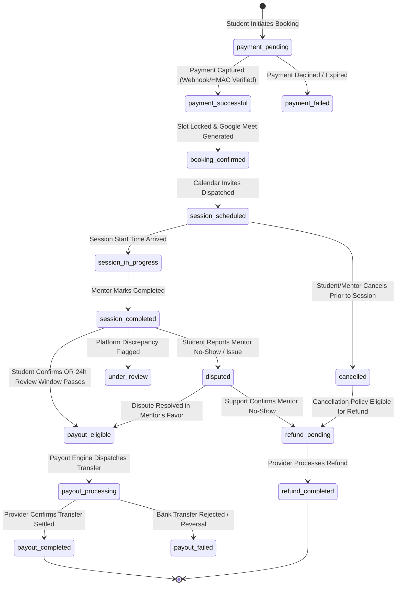

# Protected Mentor Payments & Delayed Mentor Payouts Architecture

## 1. Executive Summary & Objective

PathPilot AI operates a two-sided marketplace pairing ambitious university students with vetted industry mentors. The objective of this architecture is to enforce a **protective marketplace payment lifecycle**:
1. **Upfront Student Payment**: Students pay the full displayed consultation fee before booking confirmation.
2. **Escrow/Nodal Protection**: Customer funds are never held in an unlicensed corporate account. Funds are processed through a regulated payment provider (Razorpay Route / nodal account) with delayed settlement holds.
3. **Delayed Mentor Payouts**: Mentors never receive immediate payouts upon booking. Earnings are released only after session completion and student confirmation (or expiration of a disclosed 24-hour review window).
4. **Student Protection Against No-Shows**: If a mentor fails to attend, the student can report mentor absence, immediately freezing payout eligibility and triggering an automated or support-assisted refund workflow.

---

## 2. Regulatory Compliance & Payment Provider Evaluation

### 2.1 Indian Regulatory Landscape (RBI PA/PG Master Directions)
Under Reserve Bank of India (RBI) guidelines for Payment Aggregators (PAs) and Payment Gateways (PGs):
- **E-Commerce/Marketplace Platforms cannot pool customer money in their ordinary current bank accounts** or run an unlicensed digital wallet/escrow service.
- Marketplace funds must be routed through an RBI-authorized Payment Aggregator that maintains a designated **Nodal/Escrow Account** with a scheduled commercial bank.
- Transfers to sub-merchants (mentors) must happen via compliant split settlement mechanisms.

### 2.2 Payment Provider Evaluation Matrix

| Criterion | Razorpay Route (Recommended) | Cashfree Marketplace | Stripe Connect (India) |
| :--- | :--- | :--- | :--- |
| **Marketplace Settlement Split** | Supported via Linked Accounts API | Supported via Split Payments API | Restricted in India (Cross-border limits) |
| **Settlement Hold Capability** | `on_hold: 1`, `hold_until: timestamp` | Supported via vendor payment hold | Supported via transfer groups & holds |
| **Partial / Full Refunds** | Reverses from nodal hold before payout | Reverses from unsettled vendor balance | Reverses from destination account |
| **KYC / KYB Requirements** | Mentor PAN, Bank Account / UPI verification | Vendor bank verification | Full business PAN & GSTIN (heavy for individuals) |
| **Compliance Approval** | Requires Razorpay Marketplace approval | Requires Cashfree Marketplace approval | Limited availability for local INR-to-INR |
| **Verdict** | **Primary Choice for PathPilot AI** | **Alternative / Backup** | **Not suitable for Indian individual mentors** |

### 2.3 Production Eligibility & Compliance Guardrails
Before production payouts can be enabled:
1. PathPilot AI entity must complete Razorpay Route onboarding and sign the Marketplace Agreement.
2. Mentors must be onboarded as Razorpay "Linked Accounts" with verified PAN and bank account details.
3. In `sandbox` mode, synthetic split transfers and webhook simulations validate the state transitions safely without moving real currency.
4. **Safety Assertion**: Production transfers are strictly blocked via feature flags (`PAYMENT_MODE=sandbox`) until formal compliance verification.

---

## 3. End-to-End Funds Flow & State Machine

### 3.1 Detailed Step-by-Step Flow

1. **Order Initiation (`payment_pending`)**:
   - Student selects mentor and time slot.
   - Server calculates total price, platform commission (e.g. 15%), and mentor share (85%).
   - Creates a server-side order with `idempotency_key` and state `payment_pending`.
2. **Provider Collection (`payment_successful`)**:
   - Student pays through Razorpay Checkout.
   - Provider emits `payment.captured` webhook. Server verifies HMAC-SHA256 signature.
   - Server stores `payment_id`, `order_id`, and marks payment as `payment_successful`.
3. **Booking Confirmation (`booking_confirmed` & `session_scheduled`)**:
   - Calendar slot is locked.
   - Genuine Google Meet link is scheduled. iCalendar (.ics) invite is generated.
4. **Session Execution (`session_completed`)**:
   - Following the scheduled call, the mentor marks the consultation as "Completed".
   - State advances to `session_completed`.
   - A 24-hour **Student Review Window** begins. An automated notification invites the student to confirm the session or report any issue.
5. **Completion Verification & Payout Release (`payout_eligible`)**:
   - **Scenario A (Student Confirms)**: Student clicks "Confirm Session Completed". Payout state immediately becomes `payout_eligible`.
   - **Scenario B (Auto-Resolution)**: If 24 hours elapse with no dispute raised, the system automatically marks the booking `payout_eligible`.
   - **Scenario C (Mentor No-Show / Dispute)**: If the student clicks "Report Mentor Absence", payout eligibility is instantly frozen. Status transitions to `disputed` / `under_review`.
6. **Settlement & Payout (`payout_completed`)**:
   - When payout batch executes, only bookings with status `payout_eligible` are processed.
   - Fund transfers are recorded with provider payout IDs in `payouts` ledger.

---

## 4. Business Policies & Disputed Scenarios

| Event | Policy | Payout Action | Refund Action |
| :--- | :--- | :--- | :--- |
| **Mentor No-Show** | Zero tolerance. Student gets 100% refund. | Payout cancelled / forfeited | 100% refund issued to student |
| **Mentor Cancellation** | Mentor cancels > 2 hrs in advance. | Payout cancelled | 100% refund or optional 1-click reschedule |
| **Student Cancellation (> 12h)** | Full refund minus standard gateway processing fee (if applicable). | Payout cancelled | Full refund issued |
| **Student Cancellation (< 2h)** | Late cancellation policy: 50% retained for mentor time reserve. | 50% mentor earnings eligible | 50% partial refund issued |
| **Student No-Show** | Mentor waited 15 mins with proof of attendance. | 100% mentor earnings eligible | No refund |
| **Technical Disruption** | Meet failure or call disrupted within first 10 minutes. | Payout suspended | Rescheduled or 100% refund after support review |

---

## 5. Security, Auditing & Idempotency Rules

1. **Server-Side Authorization**: No client-side payment confirmation is accepted without cryptographic HMAC verification of the provider payload.
2. **Idempotency Keys**: All payment creation, refund initiation, and payout requests require a unique idempotency key (`idempotency_key = sha256(booking_id + action + attempt)`). Duplicate calls return the original transaction without re-execution.
3. **Dual-Key Ledger**:
   - `booking_payment_records` records the student inflow.
   - `mentor_earnings` records mentor entitlement.
   - `platform_commissions` records platform take-rate.
   - `payouts` records the sub-merchant disbursement.
   - `refunds` records student reimbursements.
4. **Immutable Audit Trail**: Every status transition logs `previous_status`, `new_status`, `actor`, `timestamp`, and `provider_reference`.

