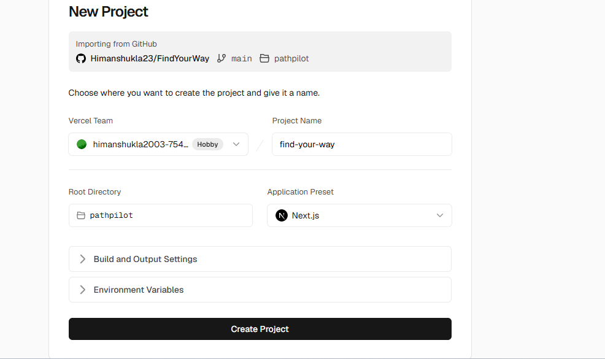

# 🚀 Job Board & Intelligence Engine (Architecture Spec 2.0)

> **Document Name**: `architecture2.md`  
> **Target Project**: PathPilot / FindYourWay  
> **Objective**: Build a high-performance, live-verified Job Board and Match Engine inspired by `pm-launchpad.vercel.app`, integrated directly into PathPilot's ecosystem (Career Roadmap + AI Resume Matcher + Supabase).

---

## 🏛️ System Overview

```
┌────────────────────────────────────────────────────────────────────────┐
│                        DATA INGESTION & SCRAPING                       │
│  • Public ATS APIs (Greenhouse, Lever, Keka)                           │
│  • Free Aggregator APIs (Arbeitnow, Remotive, JSearch)                 │
│  • Scheduled Cron Verification Bot (12-hour link validity checker)    │
└──────────────────────────────────┬─────────────────────────────────────┘
                                   │
                                   ▼
┌────────────────────────────────────────────────────────────────────────┐
│                         BACKEND & STORAGE                              │
│  • FastAPI Jobs Router (/api/jobs, /api/jobs/match, /api/jobs/sync)   │
│  • Supabase Database: `jobs`, `saved_jobs`, `applied_jobs` tables      │
│  • Gemini / Groq: Automated Skill & JD Parsing + Fit-Score Engine     │
└──────────────────────────────────┬─────────────────────────────────────┘
                                   │
                                   ▼
┌────────────────────────────────────────────────────────────────────────┐
│                        NEXT.JS 15 FRONTEND                             │
│  • High-speed Client-Side Filtering (Zero-latency Search & Tabs)      │
│  • Split-Pane / Modal Job Details with verified hiring contacts       │
│  • 1-Click "Match with my Resume" scoring badge                        │
│  • Saved / Applied Tracker synchronized with Supabase Auth            │
└────────────────────────────────────────────────────────────────────────┘
```

---

## 📅 Phase-Wise Implementation Roadmap

### **Phase 1: Database Schema & Job Models (Data Foundation)**
Establish the data contract for structured job storage in Supabase and FastAPI Pydantic schemas.

- **Supabase Table: `jobs`**
  - `id`: UUID (Primary Key)
  - `title`: String (e.g. "Associate Product Manager", "Frontend Engineer")
  - `company`: String
  - `company_logo`: String (URL)
  - `location`: String (e.g. "Bengaluru, Karnataka", "Remote")
  - `country`: String ("India", "USA", "Global")
  - `work_mode`: Enum (`Remote`, `Hybrid`, `On-site`)
  - `exp_min`: Integer (0 for freshers)
  - `exp_max`: Integer
  - `salary_display`: String (e.g. "₹8–12 LPA", "Not Disclosed")
  - `skills`: Text Array (`['SQL', 'PRD', 'Agile']`)
  - `role_category`: String (`Product`, `Engineering`, `Design`, `Analytics`)
  - `tier`: Integer (1: Tech Giants, 2: Funded Unicorns, 3: Startups)
  - `apply_url`: String (Direct link to official posting)
  - `source`: String (e.g. "Greenhouse", "Wellfound", "Cutshort")
  - `status`: Enum (`active`, `closed`, `new`)
  - `jd_summary`: Text
  - `jd_full`: Text
  - `hiring_contact`: JSONB `{ "name": "...", "role": "...", "linkedin": "..." }`
  - `verified_at`: Timestamp
  - `posted_at`: Timestamp

- **User Activity Tables**:
  - `user_saved_jobs`: `(user_id, job_id, created_at)`
  - `user_applied_jobs`: `(user_id, job_id, applied_at, notes)`

---

### **Phase 2: Ingestion & Verification Engine (Backend)**
Automated pipeline to populate and verify jobs without manual data entry.

1. **Free / Multi-Source Job Ingestors**:
   - **ATS Connectors**: Direct public JSON feeds from popular ATS providers (e.g., Greenhouse API: `https://boards-api.greenhouse.io/v1/boards/{company}/jobs`).
   - **Public Job APIs**: Integration with Arbeitnow & Remotive endpoints for verified tech and product roles.
   - **Seed Dataset**: Pre-curated seed batch of verified Indian fresher/early-career roles to launch immediately with 100+ opportunities.

2. **Verification Bot (Link Health Checker)**:
   - A lightweight asynchronous verification task (`backend/services/job_verifier.py`).
   - Pings job URLs using HTTP `HEAD` / `GET` with realistic headers.
   - Automatically marks jobs as `closed` if status is `404`, `410`, or redirected to general careers pages.

3. **FastAPI Endpoints**:
   - `GET /api/jobs`: Fast paginated or full-cached jobs payload.
   - `GET /api/jobs/{id}`: Detailed job description + hiring contact lookup.
   - `POST /api/jobs/sync`: Admin trigger for automated crawler sync.

---

### **Phase 3: AI Resume Matcher & Score Engine (Differentiating Feature)**
*Supercharging beyond PM-Launchpad by connecting your existing PathPilot AI tools:*

1. **Fit-Score Calculation**:
   - When a logged-in user with an uploaded resume views a job, the backend / Gemini analyzes:
     - **Skill Overlap Score** (0–100%)
     - **Missing Critical Skills** (e.g. "You need SQL & A/B testing for this role")
     - **Resume Match Insights**: "Your background in React matches 85% of this APM requirement."
2. **Instant "Tailor Resume" Action**:
   - 1-click button on each job card to recommend resume bullet adjustments tailored to that job's JD.

---

### **Phase 4: High-Performance Frontend UI (Next.js 15)**
Create a responsive interface matching the speed and polish of `pm-launchpad`.

1. **Interactive Control Bar**:
   - **Search Input**: Instant title/company search with debounced typing.
   - **Region Segment**: Toggle `India` vs. `International / Remote`.
   - **Filters**: Role Category, Experience (0-1 yrs, 1-3 yrs, 3+ yrs), Location, Company Tier.
   - **Sort**: Newest first, High to Low salary, Best AI match.

2. **Job Cards Grid**:
   - Company brand icon with initials/logo.
   - "Fresh / Cycle-Checked" live pulse indicator.
   - Salary badge & experience tags.
   - Quick action buttons: `Details`, `Save ♥`, `Direct Apply ↗`.

3. **Split-Screen / Modal Details View**:
   - Full parsed job description and responsibilities.
   - Verified hiring contacts (Recruiter name, LinkedIn lookup link).
   - "Mark as Applied" progress tracker.

---

### **Phase 5: User Dashboard & Tracking Integration**
Unify the Job Board with PathPilot's main learner dashboard.

- **"My Applications" Tab**: Kanban/list view tracking: *Saved $\rightarrow$ Applied $\rightarrow$ Interviewing $\rightarrow$ Offered*.
- **Sync with Career Roadmaps**: "Ready to apply?" prompt that connects completed roadmap milestones directly to hiring companies looking for those exact skills.

---

## 🛠️ Tech Stack Summary

| Layer | Technology |
| :--- | :--- |
| **Frontend** | Next.js 15 (App Router), React, Tailwind CSS, Lucide Icons |
| **Backend API** | FastAPI (Python 3.11), HTTPX, Pydantic |
| **Database & Auth** | Supabase (PostgreSQL, Row Level Security) |
| **AI Intelligence** | Google Gemini 2.5 Flash / Groq (Llama-3.3) for JD parsing & Fit-Score |
| **Deployment** | Vercel (Frontend) + Render (Backend API) |
